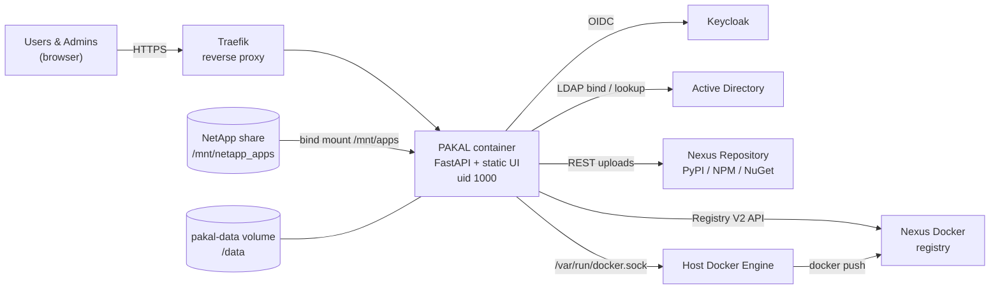

<div align="center">


# PAKAL (פ.ק.ל)

**Package & Application Kit Architecture Layer**

A secure, enterprise-grade DevOps portal that unifies software distribution,
artifact publishing, Docker CI/CD pipelines and dynamic system management -
behind one sign-in.


</div>

---

## Table of contents

- [Overview](#overview)
- [Key features](#key-features)
- [Dynamic architecture](#dynamic-architecture)
- [Authentication & sessions](#authentication--sessions)
- [Catalog scanning](#catalog-scanning)
- [Tech stack](#tech-stack)
- [Architecture & system integration](#architecture--system-integration)
- [Quick start & deployment](#quick-start--deployment)
- [Configuration reference](#configuration-reference)
- [Project directory structure](#project-directory-structure)
- [API surface](#api-surface)
- [Security guidelines](#security-guidelines)
- [Operations](#operations)

---

## Overview

PAKAL is the internal front door for developers and IT staff. From a single bilingual
(Hebrew / English) web portal, users can:

- **Find and download approved software** - installers are discovered recursively on the
  organisation's NetApp share, enriched with icons, versions and descriptions.
- **Install a whole toolchain at once** with role-based bundles delivered as one ZIP archive.
- **Browse internal platforms** (GitLab, Jira, Confluence, …) separately from **Nexus artifact repositories**.
- **Publish artifacts** (Python, NPM, PowerShell / NuGet) to Nexus in bulk.
- **Build and push Docker images** from a plain project ZIP - no local Docker required.
- **Browse the organisational Docker registry** with a Docker Hub-grade experience.

Administrators manage catalog content, Actions, Platforms, Repositories, integrations and
announcements from a hidden, **database-backed** admin console. Adding a card, reordering the
hub or hiding a tab does **not** require a redeploy.

---

## Key features

### Actions Hub (metadata-driven)

The Actions tab is a dynamic hub. Cards come from the `actions` table, not from a hardcoded
list in the frontend.

| Kind | Behaviour |
|---|---|
| **Built-in** (`nexus`, `powershell`, `docker`) | Code-backed panels: Nexus uploader, PowerShell 7 setup, Docker Image Builder. Titles, descriptions, icons, chips, order and **enabled** are admin-editable. The three engines stay in code (no arbitrary command execution). |
| **Custom link / download** | Admin-defined cards that open a URL or download a file. No server-side script runner. |

Built-in tools:

| Tool | Highlights |
|---|---|
| **Nexus Artifacts Uploader** | Drag & drop files **or whole folders** &bull; automatic format detection (`.whl` / `.tar.gz` → PyPI, `.tgz` → NPM, `.nupkg` → PowerShell) &bull; per-row target repository &bull; concurrent uploads with progress &bull; cancel via `AbortController` |
| **PowerShell 7 setup** | One installer plus NuGet / organisational PS repository registration |
| **Docker Image Builder** | Project ZIP with a `Dockerfile` &bull; server-side build → tag → push &bull; live SSE log |

Show, hide and reorder cards in **Admin → Actions**. Disabling a row removes it from the public
catalog immediately (`Action.enabled`).

### Platforms vs Repositories

These are two different catalogs, both CRUD-managed in the admin console.

| Tab | Purpose | Storage | Click behaviour |
|---|---|---|---|
| **Platforms** | Developer tools and SaaS (GitLab, Jira, Confluence, Mattermost, …) | `platforms` table | Opens the platform URL |
| **Repositories** | Nexus artifact repositories (PyPI, npm, NuGet, Docker, Maven, apt, …) | `repositories` table | `pypi` / `docker` open the built-in browsers; other types open the Nexus browse URL |

First-run seeds (`DEFAULT_PLATFORMS`, `DEFAULT_REPOSITORIES` in `pakal/knowledge.py`) are applied
once. After that, every change is live in SQLite.

### Docker Registry Catalog

A native Docker Hub-style experience, rendered **in English and LTR** even when the rest of the
portal is in Hebrew. Searchable catalog, inspect modal, copy-ready `docker pull` / `run` /
`compose` snippets, secrets masking, and a safe Markdown renderer for image READMEs.

### Role-Based Software Bundles

Curated toolchains (Electronics, Software, SysAdmin / NetOps, Essentials, Fullstack, DevOps,
Data, QA, UI/UX). Each bundle downloads as **one ZIP**. Bundles are fully editable in
**Admin → Stacks**. The lists in `knowledge.py` are first-run seeds only.

### Admin Console & Governance

- Served only from a configurable secret path (`ADMIN_SECURE_PATH`); `/admin` returns **404**.
- **Database-backed settings** - Keycloak, LDAP, Nexus, Docker, portal tabs and feature toggles
  are edited live. Console values win over environment seeds.
- **RBAC** - admin rights come from the Keycloak admin role or an LDAP admin group.
- **Emergency fallback** - a local service account that works when Keycloak and LDAP are down.
  See [`EMERGENCY_ADMIN_README.md`](EMERGENCY_ADMIN_README.md).

---

## Dynamic architecture

Hardcoded UI catalogs were removed in favour of SQLAlchemy models created on startup
(`Base.metadata.create_all`). No Alembic step is required.

| Entity | Table | Admin UI | Public API |
|---|---|---|---|
| Actions | `actions` | Admin → Actions | `GET /api/apps` → `actions` (enabled rows only) |
| Platforms | `platforms` | Admin → Platforms | `GET /api/apps` → `platforms` |
| Repositories | `repositories` | Admin → Repositories | `GET /api/apps` → `repositories` |
| Bundles / stacks | `dev_stacks` | Admin → Stacks | `GET /api/apps` → `bundles` |
| App overrides | `app_overrides` | Admin → Apps | merged into catalog apps |
| Integration settings | `settings` | Admin → SSO / Nexus / Interface | `/api/auth/me`, `/api/ui`, `/api/actions/config` |

**What stays in code (intentionally):**

- The three built-in **tool engines** (Nexus upload, PowerShell setup, Docker build). Cards are
  dynamic; execution is not a generic RCE runner.
- **KNOWN_APPS** in `knowledge.py` - installer matching, icons, categories and descriptions used
  by the share scanner. This is a recognition dictionary, not a UI list.
- Portal **feature flags** (`portal_ui.ELEMENTS`) - which chrome tabs/buttons exist. Admins toggle
  them; adding a brand-new tab still needs a code change.

**Migration:** existing deployments that hid Actions via the old `action_visibility` settings map
are migrated once on startup (`migrated_action_visibility`) onto `Action.enabled`.

---

## Authentication & sessions

Three sign-in paths, in this order of use:

1. **Keycloak OIDC** (authorization code + PKCE), including **silent SSO** (`prompt=none`) on first
   visit when SSO is configured and the user already has an IdP session.
2. **LDAP / Active Directory** username + password (unchanged, always available when configured).
3. **Local emergency admin** (`ADMIN_USERNAME` + `ADMIN_PASSWORD_HASH`).

### Session cookies

| Cookie | Scope | SameSite |
|---|---|---|
| `pakal_user` | Portal user JWT | Lax |
| `pakal_admin` | Admin-console JWT | Lax (CSRF still enforced with `X-PAKAL-Request: 1`) |
| `pakal_sso_tx` | OAuth transaction | Lax, path `/api/auth/sso` |
| `pakal_idt` | Id token hint | Lax, path `/api/auth` |

`COOKIE_SECURE` defaults to `auto` (Secure on HTTPS). Behind Traefik this should stay true.

### Behaviour that was fixed

- **Silent SSO on first entry** - `/api/auth/me` no longer blocks on a synchronous Keycloak probe.
  Reachability is cached and warmed in the background (`sso.reachable_hint`). A probe hiccup cannot
  suppress auto-login or hide the SSO button.
- **First-click SSO** - the same non-blocking `/api/auth/me` plus a manual click that always wins
  over a pending relogin countdown. If SSO still fails after a hard refresh, check that
  `KEYCLOAK_REDIRECT_URI` matches the public origin (scheme + host) exactly; a proxy that drops
  `X-Forwarded-Proto` will break the `state` cookie.
- **LDAP** - credential bind path is independent of SSO reachability.
- **Back to Portal** - `/api/auth/me` treats a valid admin-console session as authenticated, so a
  local/LDAP admin is not bounced into silent SSO and does not appear signed out.

---

## Catalog scanning

The software share is walked recursively:

```text
<APPS_ROOT>/
  Visual Studio/17.8/vs_setup.exe          installer walk (MAX_SCAN_DEPTH)
  microsoft/visual studio/2022/setup.exe   vendor grouping (MAX_VENDOR_DEPTH) + installer walk
```

- `iter_app_roots()` descends vendor/grouping folders and treats version/OS/arch folders as part
  of the parent app, not as separate catalog entries.
- `walk_app()` collects primary installers up to `MAX_SCAN_DEPTH` (default **8**).
- Clutter directories (`node_modules`, `payloads`, `.git`, …), Visual Studio offline layouts and
  extracted-app trees are skipped or collapsed to a single launcher.

Trigger a rescan from **Admin → Overview → Rescan**, or wait for `AUTO_RESCAN_MINUTES`.
Uploading an installer into an app folder also queues a rescan.

---

## Tech stack

| Layer | Technology |
|---|---|
| Backend | **FastAPI** (Python 3.11), Uvicorn, Pydantic v2, SQLAlchemy 2 |
| Persistence | SQLite (`/data/pakal.db`), JSON scan cache |
| Identity | **Keycloak** (OIDC) and **LDAP / AD** (`ldap3`), bcrypt local emergency account, signed JWT cookies |
| Artifacts | **Nexus Repository Manager** REST API (PyPI, NPM, NuGet / PowerShell) |
| Containers | **Docker Engine API** over `/var/run/docker.sock`; **Nexus Docker Registry V2 API** |
| Icons | `icoextract`, `pefile`, `olefile` |
| Frontend | Dependency-free **Vanilla JS & CSS**, RTL / LTR, light & dark, self-hosted fonts |
| Delivery | Docker image, Docker Compose, Traefik reverse proxy (TLS) |

---

## Architecture & system integration



**Host Docker socket sharing.** The container runs as uid 1000 and joins the socket group via
`group_add: ${DOCKER_GID}`.

**NetApp storage.** Host path `/mnt/netapp_apps` is bind-mounted at `/mnt/apps` (`APPS_ROOT`).

**Nexus.** Connection details and per-format repositories are configured in the admin console.
Uploads are validated server-side and forwarded with a service account. The Repositories tab is
the user-facing catalog of those Nexus repos; the Actions uploader is the write path.

---

## Quick start & deployment

### Prerequisites

- Docker Engine 24+ with the Compose plugin on a Linux host
- The NetApp software share mounted on the host at `/mnt/netapp_apps`
- An external Docker network named `proxy` shared with Traefik
- Network reachability to Keycloak / LDAP / Nexus (each integration is optional)

### 1. Configure the environment

```bash
cp .env.example .env
chmod 600 .env
# edit .env - registry, host name, Keycloak, LDAP, Nexus ...
```

`.env` is git-ignored. Every value in `.env.example` is a placeholder.

### 2. Allow access to the host Docker socket

```bash
stat -c '%g' /var/run/docker.sock      # e.g. 999
```

Put the value in `.env` as `DOCKER_GID=999`.

### 3. Create the emergency admin password

```bash
docker compose run --rm pakal python -m pakal.security hash-password
```

Paste the hash into `.env` **inside single quotes**:

```bash
ADMIN_PASSWORD_HASH='$2b$12$...'
```

Default local username is **`pakal`** (`ADMIN_USERNAME`), not `admin`.

### 4. Build and run

```bash
docker compose build          # or pull from ${PAKAL_REGISTRY}
docker compose up -d
docker compose logs -f pakal
```

Portal: `https://${PAKAL_HOST}`  
Admin console: `https://${PAKAL_HOST}${ADMIN_SECURE_PATH}`

On first boot the database creates missing tables (`actions`, `repositories`, …) and seeds
built-in actions plus default platforms/repos if the tables are empty. No extra migrate command.

### Local development

```bash
python -m venv .venv
. .venv/bin/activate              # Windows: .venv\Scripts\activate
pip install -r requirements.txt
export APPS_ROOT=./test_apps DATA_DIR=./data COOKIE_SECURE=false LOCAL_ADMIN_PASSWORD='choose-a-local-password'
uvicorn main:app --reload --port 8971
```

On Windows PowerShell:

```powershell
$env:APPS_ROOT = "$PWD\test_apps"
$env:DATA_DIR = "$PWD\data"
$env:COOKIE_SECURE = "0"
$env:LOCAL_ADMIN_PASSWORD = "choose-a-local-password"
python -m uvicorn main:app --reload --port 8971
```

---

## Configuration reference

All variables are documented in [`.env.example`](.env.example). The most important ones:

| Variable | Purpose | Example |
|---|---|---|
| `PAKAL_REGISTRY` / `PAKAL_VERSION` | Where the portal image is pulled from | `registry.example.com:5000` / `1.8` |
| `PAKAL_HOST` | Public host name (Traefik rule) | `pakal.example.com` |
| `ADMIN_SECURE_PATH` | Secret path of the admin console | `/pakal-management-console` |
| `ADMIN_USERNAME` | Local emergency username | `pakal` |
| `ADMIN_PASSWORD_HASH` | bcrypt hash of the emergency local admin | `'$2b$12$...'` |
| `DOCKER_GID` | Group id of `/var/run/docker.sock` | `999` |
| `MAX_SCAN_DEPTH` | Nested installer folders inside an app | `8` |
| `MAX_VENDOR_DEPTH` | Vendor/grouping folders under the share root | `6` |
| `AUTO_RESCAN_MINUTES` | Background catalog refresh | `30` |
| `KEYCLOAK_URL`, `KEYCLOAK_CLIENT_SECRET`, `KEYCLOAK_REDIRECT_URI` | OIDC SSO | public callback URL |
| `LDAP_URL`, `LDAP_SEARCH_BASE`, `LDAP_ADMIN_GROUP_DN` | Directory sign-in | `ldap://dc01.example.com:389` |
| `NEXUS_URL`, `NEXUS_*_REPO` | Artifact uploader targets (seed) | `https://nexus.example.com` |
| `NEXUS_DOCKER_REGISTRY` | Docker catalog & build push target | `nexus.example.com:5000` |
| `COOKIE_SECURE` | Cookie Secure flag (`true` / `false` / `auto`) | `auto` |

> Integration values (Keycloak, LDAP, Nexus, Docker) only **seed** the admin console. Once saved
> in the console they are stored in the database and take precedence.

---

## Project directory structure

```text
.
├── main.py                     # ASGI entry point (uvicorn main:app)
├── Dockerfile                  # python:3.11-slim, non-root uid 1000
├── docker-compose.yml
├── requirements.txt
├── .env.example
├── EMERGENCY_ADMIN_README.md
├── pakal/
│   ├── app.py                  # factory, CSP, lifespan
│   ├── config.py               # environment configuration
│   ├── db.py, models.py        # SQLite schema, seeding & one-shot migrations
│   ├── knowledge.py            # scanner dictionary + first-run seeds
│   ├── security.py             # sessions, bcrypt, CSRF, rate limiting
│   ├── auth_config.py          # DB-backed integration settings
│   ├── sso.py                  # Keycloak OIDC (+ non-blocking reachability)
│   ├── directory.py            # LDAP / Active Directory
│   ├── scanner.py, store.py    # recursive share scanner + catalog
│   ├── portal_ui.py            # tab / button feature toggles
│   ├── nexus.py, docker_*.py
│   ├── routes_public.py        # catalog, downloads, health
│   ├── routes_auth.py          # SSO / LDAP / session
│   ├── routes_actions.py       # Nexus uploader API
│   ├── routes_docker.py / routes_pypi.py
│   ├── routes_manage.py        # admin installer uploads + card status
│   └── routes_admin.py         # console API (CRUD for platforms, repos, actions, …)
└── static/                     # portal + admin console (no bundler)
```

---

## API surface

| Area | Endpoints |
|---|---|
| Catalog | `GET /api/apps` (apps, bundles, platforms, **repositories**, **actions**), `GET /api/apps/{id}`, docs/readme/license, `GET /api/icon/{id}`, `GET /api/download/{path}`, `GET /api/bundles/{id}/download-zip`, `GET /api/ui`, `GET /api/status`, `GET /api/health` |
| Auth | `GET /api/auth/sso/login`, `GET /api/auth/sso/callback`, `POST /api/auth/ldap/login`, `GET /api/auth/me`, `POST /api/auth/logout`, `POST /api/feedback` |
| Actions | `GET /api/actions/config`, `GET /api/actions/powershell`, `PUT /api/actions/upload` |
| Docker | `GET /api/docker/config`, `GET /api/docker/images`, `GET /api/docker/image`, `POST /api/docker/build-and-push` *(SSE)* |
| PyPI | `GET /api/pypi/packages?q=`, `GET /api/pypi/download?path=` |
| Admin | `/api/admin/*` (session + admin role), including `/api/admin/actions` and `/api/admin/repositories` |
| Manage | `PUT /api/manage/card-status`, `PUT /api/manage/apps/{id}/files`, `POST /api/manage/apps/{id}/installers` |

State-changing requests must send the `X-PAKAL-Request: 1` header (CSRF protection).

---

## Security guidelines

| Area | Policy |
|---|---|
| **Secrets** | Real values live only in `.env` (git-ignored, `chmod 600`). No default passwords ship in the image. Integration secrets saved in the console are never returned to the browser. |
| **RBAC** | Admin rights from Keycloak admin role or LDAP admin group. Console only at `ADMIN_SECURE_PATH`. |
| **Actions** | Custom actions are links/downloads only. Built-in tools run fixed server code. There is no arbitrary command execution. |
| **Docker socket** | Root-equivalent on the host. Any signed-in user can start a build. Contexts are size-limited, extracted safely and deleted after each job. |
| **Web hardening** | CSP `script-src 'self'`, `X-Frame-Options: DENY`, CSRF header, rate-limited logins, Secure cookies behind TLS. |
| **Emergency access** | Follow [`EMERGENCY_ADMIN_README.md`](EMERGENCY_ADMIN_README.md). |

---

## Operations

```bash
docker compose ps                                   # health status
docker compose logs -f pakal                        # live logs
docker compose pull && docker compose up -d         # upgrade to ${PAKAL_VERSION}
docker compose up -d --force-recreate pakal         # re-read .env / rebuild process
docker exec pakal_appstore printenv ADMIN_SECURE_PATH
```

**After pulling this architecture:** rebuild/recreate the container. Tables are created
automatically; the Actions visibility migration runs once. Then:

1. Sign in to the admin console.
2. **Actions** - confirm the three built-in tools, enable/disable, add custom links.
3. **Repositories** - set Nexus browse URLs (seeds use `NEXUS_URL` when present).
4. **Interface** - show/hide the Repositories tab (`tab_repos`) if needed.
5. **Overview → Rescan** if the share layout uses nested vendor folders.

Persistent state lives in the `pakal-data` volume (`/data`) - include it in backups.
